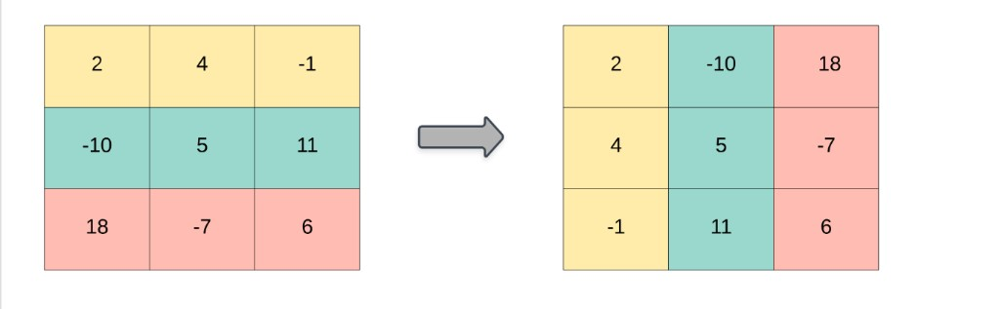

### Transpose Matrix

(Leetcode: https://leetcode.com/problems/transpose-matrix/)

Given a 2D integer array matrix, return the transpose of matrix.

The transpose of a matrix is the matrix flipped over its main diagonal, switching the matrix's row and column indices.

Example 1:

Input: matrix = [[2,4,-1],[-10,5,11],[18,-7,6]]
Output: [[2,-10,18],[4,5,-7],[-1,11,6]]
Example 2:

Input: matrix = [[1,2,3],[4,5,6]]
Output: [[1,4],[2,5],[3,6]]

Constraints:

m == matrix.length
n == matrix[i].length
1 <= m, n <= 1000
1 <= m \* n <= 105
-109 <= matrix[i][j] <= 109
