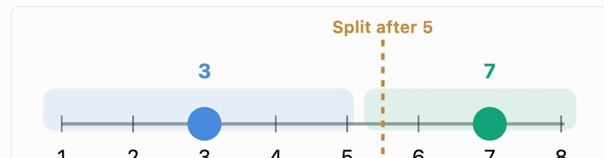

You're given an unordered list of unique integers called `nums`, in the range [1, n]
where n represents the length of `nums + 2`. This means that two numbers in this range
are missing from the list.

Write a function that takes in this list and returns a new list with the two mission numbers, sorted numerically

### Sample Input:

```
nums = [1, 4, 3]
```

### Sample Output:

```
[2, 5]
```

### Hint

You do not need to search for the two missing numbers one by one. Their positions have a split you can compute from their sum.

Suppose two children are standing on a number line, one at position 3 and the other at position 7. You do not know those positions. You only know that their positions add up to 10.

```
10 / 2 = 5
```

5 is the average of the two positions. The average of two different numbers always lies strictly between them, so one child is on one side of 5 and the other child is on the other side.



The same fact is what the algorithm uses. If the missing numbers are `a` and `b`, and `a < b`, then:

```
a < (a + b) / 2 < b
```

`a + b` is the sum of every integer from 1 through `n`, minus the sum of `nums`. You still do not know `a` and `b` separately, but you do know that average.

The values in this problem are integers, so take `floor((a + b) / 2)` and split after that integer, the same way the picture splits after 5. Every number from 1 through that boundary is the left side. Every number after it is the right side. The smaller missing number is on the left, and the larger missing number is on the right. Each side is missing exactly one value.

On each side, subtract the sum of the numbers from `nums` that fall on that side from the sum of every integer that belongs on that side. The difference is the missing number on that side. Return those two differences in increasing order.
